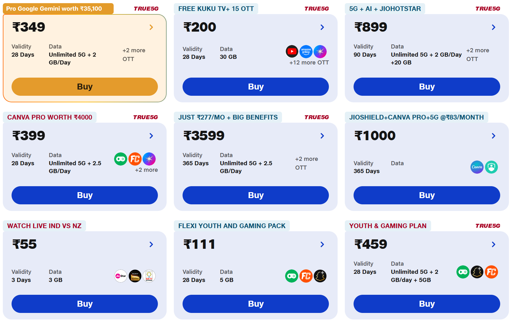
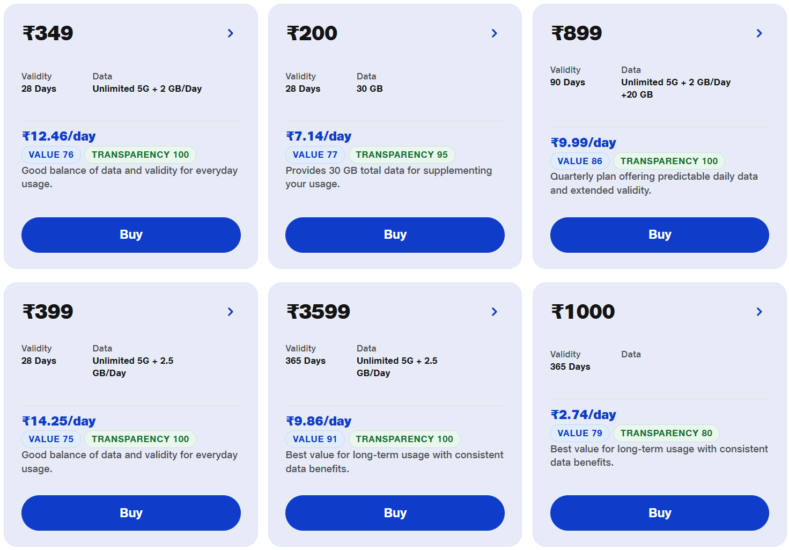
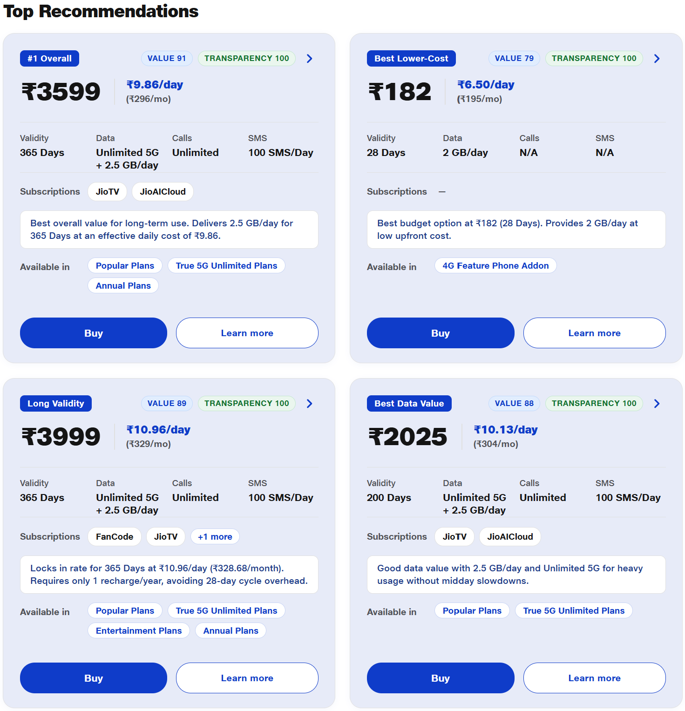
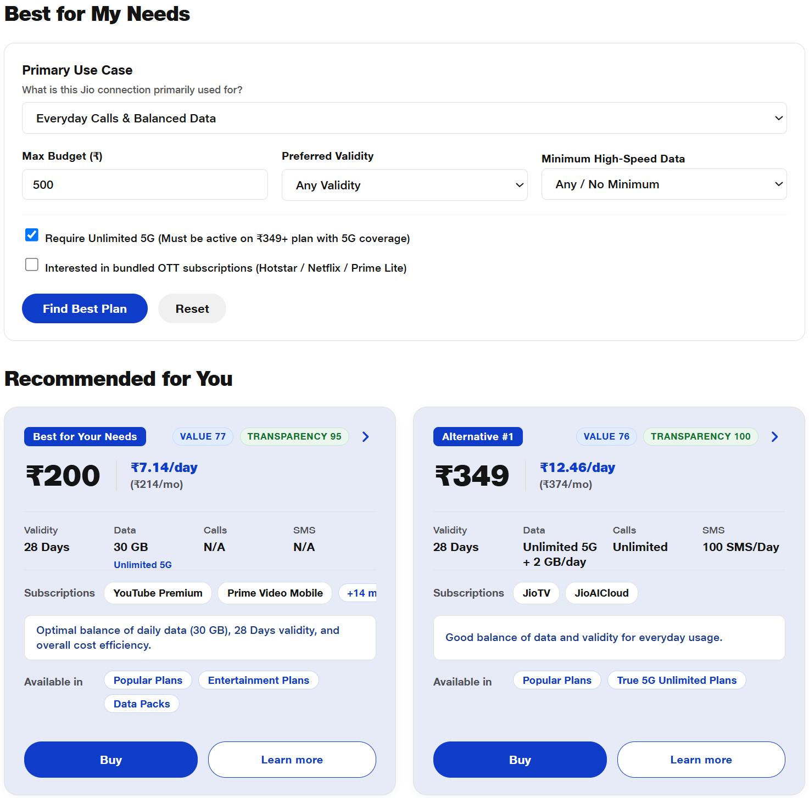
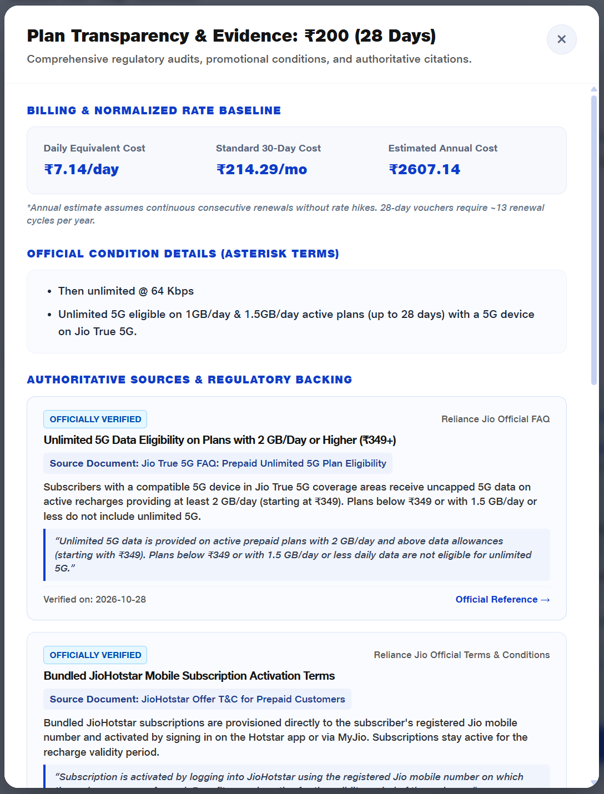
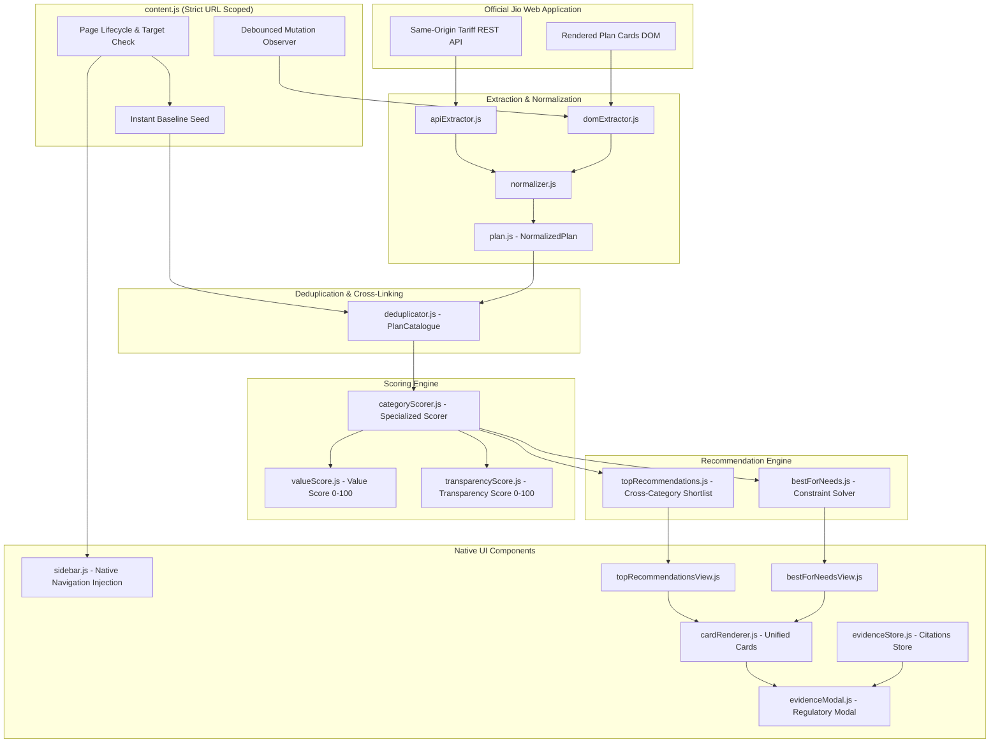

# Jio Unfiltered
> **See the value. Skip the hype.**  
> *An independent, evidence-backed Chrome extension that brings transparency, mathematical valuation, and clutter-free clarity to Jio prepaid mobile recharges.*

<p align="center">
  
</p>

<p align="center">
  
  
  
  
</p>

---

## 1. Overview & The Problem

Modern telecom recharge portals are heavily optimized for marketing conversion rather than consumer clarity. On the official Jio prepaid plans portal, consumers encounter:

- **28-Day Billing Cycles:** Standard "monthly" packs last only 28 days, compelling customers to recharge **13 times a year** ($365 / 28 \approx 13.03$) instead of 12—an unadvertised ~8.3% cost inflation.
- **Promotional Clutter & Inflated Valuations:** Marketing banners advertise exaggerated perks (e.g. *"Google Gemini Pro worth ₹35,100 free"* or *"Canva Pro"*) that disguise base tariff hikes and carry strict continuity clauses.
- **Fragmented Categories:** 190+ plans are scattered across 17 distinct category tabs, causing the same recharge to appear repeatedly with inconsistent marketing badges.
- **Hidden Conditions & FUP Throttles:** Post-quota daily data throttling drops down to 64 Kbps, data booster packs secretly require an active base plan, and third-party OTT subscriptions expire with plan validity.

**Jio Unfiltered** is a lightweight, zero-dependency browser extension that sits directly on top of the Jio prepaid catalogue (`https://www.jio.com/selfcare/plans/mobility/prepaid-plans-list/`), stripping away promotional noise and computing true cost-per-day, deterministic **Value Scores**, and regulatory **Transparency Scores**.

> [!NOTE]
> **Independent Consumer Utility:** Jio Unfiltered is an open-source consumer tool developed independently. It is not affiliated with, endorsed by, or sponsored by Reliance Jio Infocomm Ltd. All trademarks and brand names belong to their respective owners.

---

## 2. Key Features

### 🚫 1. Promotional Clutter Removal
- Conceals noisy promotional badges, animated marketing gradient overlays, and inflated valuation claims.
- Restores clean, native typography and card alignment.
- Keeps essential recharge functions (plan benefits, official asterisk terms, and the native **Buy** button) 100% operational.

### 📊 2. Normalized Daily & Monthly Cost Metrics
- Computes **Effective Daily Cost** ($\text{Price} / \text{Validity Days}$) for instant apples-to-apples comparison.
- Normalizes all vouchers to a standard **30-Day Monthly Cost** and **Estimated Annual Cost** (accounting for 13 recharge cycles on 28-day plans).
- Displays compact rate badges directly below plan prices.

### 🏆 3. Deterministic Value Score (0–100)
- Evaluates plans against real utility benchmarks: effective daily cost, high-speed data allowance (GB/day), True 5G uncapped availability, SIM retention economics, and duration stability.
- Free of arbitrary subjective weights; calibrated using live tariff data.

### 🛡️ 4. Independent Transparency Score (0–100)
- Penalizes deceptive marketing tactics, artificial 28/56/84-day billing traps, unstated base plan dependencies, and complex third-party promotional clauses.
- Rewards plans adhering to TRAI's 30-day calendar-month tariff directives and clear standalone validity.

### 🌟 5. "Top Recommendations" Shortlist
- Injects a native-styled category directly into the sidebar above *Popular Plans*.
- Scans all 17 categories to identify standouts:
  - **Best Overall Value:** Top-tier connectivity and data economics.
  - **Best Lower-Cost Alternative:** Accessible everyday recharge.
  - **Best Long-Validity:** Optimal 84-day and 365-day annual solutions.
  - **Best Heavy Data:** Highest gigabyte-per-rupee allocation.
  - **Best Value Without OTT:** Pure connectivity without bundled subscription premiums.

### 🎯 6. Personalized "Best for My Needs" Engine
- An interactive preference engine tailored to specific user archetypes:
  - *Everyday Calls & Balanced Data*
  - *Secondary SIM (OTPs & Low-Cost Retention)*
  - *Heavy Data & 5G Hotspot*
  - *OTT & Entertainment Bundling*
  - *Long Validity & Annual Recharges*
  - *International Roaming & Travel*
- Enforces strict hard constraints (budget, minimum daily data, 5G eligibility) before ranking candidates.

### 🔍 7. Verifiable Evidence & Condition Inspection Modal
- Clicking **"Learn more"** or an insight badge opens an evidence modal.
- Cites official sources: Jio Tariff Disclosures, Jio True 5G FAQ, JioHotstar T&C, and TRAI Gazette Orders.
- Assigns explicit verification statuses: `OFFICIALLY VERIFIED`, `REGULATORY SOURCE`, and `COMMUNITY REPORTED`.

---

## 3. Visual Tour

| View | Screenshot | Description |
| :--- | :--- | :--- |
| **Original Jio Page** *(Before)* |  | Cluttered with promotional banners, animated gradients, and distracting marketing tags. |
| **Decluttered Cards** *(After)* |  | Cleaned cards displaying daily equivalent rates, Value Scores, Transparency Scores, and concise insights. |
| **Top Recommendations** |  | Cross-category shortlist with distinct badges, 2-line category pills, and deep navigation links. |
| **Best for My Needs** |  | Interactive preference solver showing winning candidate, key trade-offs, and viable alternatives. |
| **Evidence & Disclosures Modal** |  | Detailed breakdown of annual cost models, official asterisk conditions, and TRAI regulatory references. |

---

## 4. System Architecture



---

## 5. Scoring & Mathematical Model

### A. Value Score Formula ($0 \le S_{\text{value}} \le 100$)

The Value Score evaluates the tangible utility delivered per rupee spent across three weighted pillars:

$$S_{\text{value}} = \min(100, \max(0, P_{\text{cost}} + P_{\text{data}} + P_{\text{validity}} + B_{\text{5G}} - P_{\text{dep}}))$$

1. **Daily Cost Efficiency ($P_{\text{cost}}$, max 45 pts):**
   $$P_{\text{cost}} = \max\left(0, 45 \times \left(1 - \frac{\text{DailyCost} - 4.0}{25.0}\right)\right)$$
   *Baseline calibrated against lowest affordable plan (~₹4.30/day on annual packs).*
2. **Data Allocation Score ($P_{\text{data}}$, max 35 pts):**
   $$P_{\text{data}} = \min\left(35, 12 \times \text{DailyDataGB}\right)$$
   *(Packs with $\ge 2.5\text{ GB/day}$ achieve full points; total-data vouchers scaled by duration).*
3. **Validity Stability ($P_{\text{validity}}$, max 15 pts):**
   - $\ge 336\text{ days}$ (Annual): $+15\text{ pts}$
   - $84\text{–}90\text{ days}$ (Quarterly): $+10\text{ pts}$
   - $28\text{–}30\text{ days}$ (Monthly): $+5\text{ pts}$
4. **True 5G Unlimited Bonus ($B_{\text{5G}}$):**
   - Active on plans $\ge ₹349$ with $\ge 2\text{ GB/day}$: $+5\text{ pts}$
5. **Base Plan Dependency Penalty ($P_{\text{dep}}$):**
   - Supplementary data add-on requiring active base plan: $-15\text{ pts}$

---

### B. Transparency Score Formula ($0 \le S_{\text{transparency}} \le 100$)

The Transparency Score begins at $100$ and applies deterministic deductions for deceptive or restrictive terms:

$$S_{\text{transparency}} = 100 - \sum \text{Deductions}$$

| Factor | Condition / Trap Detected | Impact |
| :--- | :--- | :---: |
| **Billing Cycle Trap** | Plan uses 28, 56, or 84-day cycle forcing 13 recharges/year | **-10 pts** |
| **Base Plan Dependency** | Pack lacks standalone voice/validity (Data booster) | **-25 pts** |
| **Post-Quota Throttle** | Speed restricted to 64 Kbps without prominent disclosure | **-5 pts** |
| **Complex Promo Tie-in** | Third-party offer (Gemini/Canva) requiring uninterrupted recharges | **-15 pts** |
| **High Per-Day Premium** | Daily equivalent cost exceeds ₹20/day on short validity | **-10 pts** |
| **TRAI Calendar Month Compliance** | Complies with TRAI mandate for 30-day/calendar-month renewal | **+5 pts** |

---

## 6. Project Structure

```text
E:\FJio\
├── .gitignore                      # Security exclusions (PEM keys, build, logs)
├── manifest.json                   # Manifest V3 configuration (Canonical dev/build source)
├── package.json                    # Scripts and dependencies (zero runtime dependencies)
├── README.md                       # Comprehensive project documentation
├── icons/                          # Canonical extension branding assets
│   ├── jio-unfiltered.svg          # Refined SVG source (emerald dollar + white rings)
│   ├── icon16.png                  # Chrome toolbar icon (16x16)
│   ├── icon48.png                  # Chrome extension manager icon (48x48)
│   └── icon128.png                 # Chrome Web Store & installation icon (128x128)
├── docs/                           # Documentation assets
│   └── images/                     # Verified extension screenshots and walkthrough images
├── scripts/                        # Build & utility tooling
│   ├── build-dist.js               # Validating distribution packager (outputs to dist/)
│   └── generate-icons.js           # Sharp-based SVG-to-PNG rasterizer
├── src/                            # Canonical editable source code
│   ├── content.js                  # Page lifecycle manager, scope guard & observer
│   ├── data/
│   │   └── baselinePlans.js        # Offline seed catalogue for zero-delay startup
│   ├── evidence/
│   │   └── evidenceStore.js        # Verifiable citations, TRAI rules & status enums
│   ├── extractors/
│   │   ├── apiExtractor.js         # Same-origin REST API background catalogue loader
│   │   ├── domExtractor.js         # DOM card scanner, declutterer & score chip injector
│   │   └── normalizer.js           # Pure regex parsers for Rupee, validity, and data
│   ├── identity/
│   │   └── deduplicator.js         # PlanCatalogue & composite fingerprint deduplication
│   ├── models/
│   │   └── plan.js                 # NormalizedPlan schema & cost normalization
│   ├── recommendations/
│   │   ├── bestForNeeds.js         # Constraint solver and preference ranking engine
│   │   └── topRecommendations.js   # Cross-category shortlist generator
│   ├── scoring/
│   │   ├── categoryScorer.js       # Category-specific valuation router
│   │   ├── transparencyScore.js    # Independent Transparency Score model
│   │   └── valueScore.js           # Deterministic Value Score model
│   ├── styles/
│   │   └── extension.css           # Vanilla CSS adhering strictly to JioType tokens
│   └── ui/
│       ├── bestForNeedsView.js     # "Best for My Needs" preferences form & view
│       ├── cardRenderer.js         # Single-column spacious recommendation cards
│       ├── evidenceModal.js        # Accessible regulatory condition & source modal
│       ├── sidebar.js              # Native category navigation injection
│       └── topRecommendationsView.js # "Top Recommendations" shortlist view
├── dist/                           # Reproducibly generated production distribution
└── tests/                          # Automated Node.js unit and integration tests
    ├── card_and_heading.test.js    # Card structure, tokens, and style tests
    ├── evidence.test.js            # Evidence URLs, statuses, and link safety tests
    ├── extraction.test.js          # Currency, validity, and data parsing tests
    ├── identity.test.js            # Fingerprinting and deduplication tests
    ├── live_catalogue.test.js      # Full 17-category live dataset integration tests
    ├── recommendations.test.js     # Recommendation shortlist and constraint tests
    └── scoring.test.js             # Value and Transparency Score algorithm tests
```

---

## 7. Technology Stack & Design Decisions

| Layer | Choice | Rationale |
| :--- | :--- | :--- |
| **Language** | Vanilla JavaScript (ES2022) | Zero runtime overhead; runs instantly without bundler baggage or framework initialization delays. |
| **Extension Platform** | Chrome Extensions Manifest V3 | Latest web platform standards, event-driven service worker model, and granular URL scoping. |
| **Styling** | Vanilla CSS with Design Tokens | Direct alignment with Jio's native `JioType` fonts, `#e7ebf8` active highlights, and single-column grid tokens. Zero Tailwind/Bootstrap bloat. |
| **Data Ingestion** | Hybrid (Seed + DOM + REST API) | Uses an offline baseline seed for instantaneous UI rendering, augmented by same-origin API fetches for full 17-category coverage. |
| **Testing** | Node.js Built-in Test Runner (`node:test`) | Zero-dependency, ultra-fast test suite executing in under 350ms. |

---

## 8. Installation & Getting Started

### Prerequisites
- Google Chrome (or Chromium-based browser: Brave, Edge, Opera, Vivaldi) v102+
- Node.js v18+ (only needed for running tests or rebuilding the distribution)

### Step 1: Clone or Download the Repository
```bash
git clone https://github.com/os-trainer/Jio-Unfiltered.git
cd Jio-Unfiltered
```

### Step 2: Build the Production Distribution
```bash
npm run build
```
*This command validates all manifest assets and compiles the ready-to-load distribution into `dist/`.*

### Step 3: Load into Google Chrome
1. Open Google Chrome and enter `chrome://extensions/` in the address bar.
2. Toggle **Developer mode** in the top-right corner.
3. Click the **Load unpacked** button in the top-left toolbar.
4. Select the `dist/` folder inside the project directory:
   ```text
   E:\FJio\dist
   ```
5. Navigate to the official Jio prepaid plans catalogue:  
   👉 [https://www.jio.com/selfcare/plans/mobility/prepaid-plans-list/](https://www.jio.com/selfcare/plans/mobility/prepaid-plans-list/)

---

## 9. Automated Testing & Verification

The project includes an automated test suite verifying every component from raw string extraction to multi-category constraint ranking:

```bash
npm test
```

### Test Suite Summary
```text
> jio-unfiltered@1.0.0 test
> node --test tests/*.test.js

✔ Recommendation Cards — Correct structure, elements, and tokens
✔ Recommendation Cards — Graceful handling of missing or incomplete data
✔ Recommendation Cards — Data-only pack calls and SMS are N/A (No Misinformation)
✔ Recommendation Cards — Subscriptions overflow capped to 2 with +N more
✔ Styles — Redirection Highlight uses primary Jio color and 1.2s duration
✔ Recommendation Cards — All available-in categories provided in two-line cluster
✔ Manifest & Startup — Baseline plans catalogue included in manifest for zero-delay startup
✔ Evidence System — Every entry contains a valid absolute HTTPS URL
✔ Evidence System — Strict status classifications and truthfulness
✔ Evidence System — Accurate claims and excerpts for 5G, Gemini, and Hotstar
✔ Evidence System — Missing URL produces safe unverified tag, never a broken link
✔ UI — Card action button displays "Learn more" (replacing "View Evidence & T&C")
✔ UI Styles — Hover lift effect is completely removed from recommendation cards
✔ Extraction — Rupee Amount Parsing
✔ Extraction — Validity Normalization
✔ Extraction — Daily vs Total Data Disambiguation
✔ Extraction — Full Raw API Plan Normalization
✔ Extraction — Malformed or Incomplete Data Handling
✔ UI Improvement — Native Card Compact Insights & Cost Logic
✔ Identity — Fingerprint Generation
✔ Identity — Same Plan Across Multiple Categories Deduplication
✔ Identity — Distinguish Different Plans with Same Price
✔ Identity — Fallback Fingerprint Deduplication without Official ID
✔ Live Jio Catalogue — Full 17-Category Dataset Ingestion & Deduplication
✔ Recommendations — Top Recommendations Shortlist Generation
✔ Recommendations — Best for My Needs (Secondary SIM Profile)
✔ Recommendations — Best for My Needs (Heavy Data & 5G Profile)
✔ Recommendations — Strict Hard Constraint Failure (No Plans Eligible)
✔ Scoring — Standard Value Score Determinism and Bounds
✔ Scoring — 28-day vs 30-day Validity Stability
✔ Scoring — Data Add-On Specialized Scorer
✔ Scoring — Transparency Score Disclosures
✔ Scoring — Top-Up Voucher Custom Category Logic

ℹ tests 33, pass 33, fail 0 (Duration: ~330ms)
```

---

## 10. Privacy, Security & Permissions

- **Zero Network Telemetry:** Jio Unfiltered does not make any external network requests, send analytics, or contact third-party servers.
- **Strict Domain Scoping:** The extension runs strictly on:
  ```text
  https://www.jio.com/selfcare/plans/mobility/prepaid-plans-list*
  ```
  It has no access to login sessions, payment details, MyJio account credentials, or browsing history.
- **Minimal Permissions:** Uses only the `storage` permission to preserve user preference choices in the "Best for My Needs" form locally on the user's device.
- **Release Hygiene:** Private signing keys (`*.pem`, `*.key`) and reproducible outputs are strictly ignored in `.gitignore`.

---

## 11. Limitations & Caveats

1. **Jio Website Changes:** Because this extension interfaces with Jio's web portal, updates to Jio's DOM element class names or API schema could affect extraction. The hybrid extractor falls back gracefully from API data to DOM parsing, and from DOM parsing to the offline baseline seed.
2. **Promotional Volatility:** Third-party partner subscriptions (e.g., Netflix, Hotstar, Gemini) frequently alter their terms. All conditions cited in the Evidence Modal reflect verified terms as of October 2026.
3. **Desktop Focused:** The UI is specifically optimized for desktop browsing where plan comparison across multiple tabs is most prevalent.

---

## 12. License

This project is open-source software licensed under the [MIT License](LICENSE).
